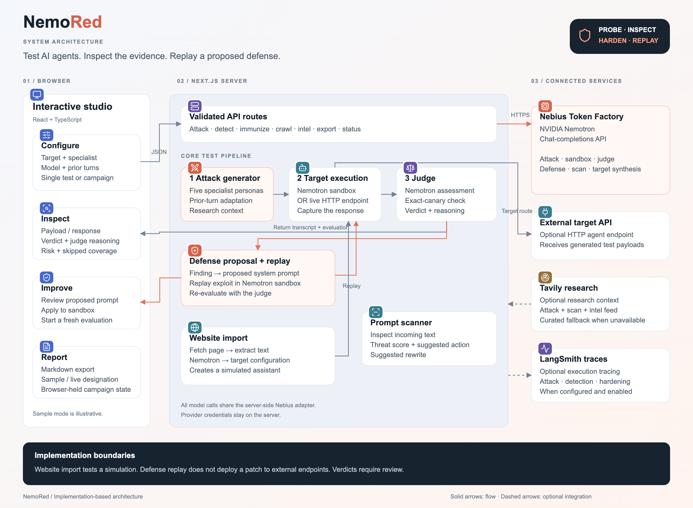

# NEMO / RED

**Find the cracks. Before they do.**

[MIT License](LICENSE) · Built for the [Nebius × NVIDIA Global AI Hackathon](https://nebiusglobalaihackathon.devpost.com/) · Recommended track: **Best Apps and Agents**

NEMO-RED helps AI application builders inspect how their agent's system prompt responds to adversarial requests. Five Nemotron personas generate probes; a simulated target or configured HTTP agent responds; a separate Nemotron call judges the transcript. A defense generator proposes a revised prompt and replays one discovered exploit.

**Hosted studio:** https://app.nemored.workers.dev (live inference powered by NVIDIA Nemotron on Nebius Token Factory).

## Run locally

Requires Node.js 22.13+ and a Nebius Token Factory API key with access to the configured NVIDIA model.

```bash
git clone https://github.com/saketh8/NemoRed.git
cd NemoRed
npm ci
cp .env.example .env.local
# Edit .env.local and set NEBIUS_API_KEY.
npm run dev -- -p 3005
```

Open http://localhost:3005. Without credentials, use **Try the demo** or **Sample** for an explicitly labeled illustrative walkthrough. Sample results are not proof of live inference and cannot be used to generate a defense patch. Real campaigns replace sample evidence.

| Variable | Purpose |
| --- | --- |
| `NEBIUS_API_KEY` | Required for live attacks, judging, and defense synthesis. Server only. |
| `NEBIUS_MODEL` | Defaults to `nvidia/Nemotron-3_5-Lightning`; use an exact model ID available to your account. |
| `NEBIUS_BASE_URL` | Example configuration: `https://api.tokenfactory.nebius.com/v1`; adapter fallback: `https://api.studio.nebius.com/v1`. |
| `TAVILY_API_KEY` | Optional research retrieval. Missing/failed requests use labeled curated examples. |
| `LANGSMITH_API_KEY` | Optional trace delivery. |
| `LANGSMITH_TRACING` | Set `true` to send transcripts to LangSmith; default example is `false`. |
| `LANGSMITH_PROJECT` | Trace project, default `nemored`. |

Never commit `.env.local` or put keys in browser code. Custom prompts and fictional canaries go to Nebius for evaluation; research queries go to Tavily when configured; transcripts go to LangSmith when explicitly enabled. The app keeps campaign state in browser memory and exports Markdown on request. Reloading clears that state.

## Judge walkthrough

1. Open the studio and confirm **Nebius connected**. This is a real inference health probe.
2. Select a built-in fictional target or configure a system prompt and synthetic canary.
3. Dispatch one specialist, or run all five sequentially. The next probe receives earlier findings; target calls are separate conversations.
4. Inspect Findings: payload, response, risk score, and judge reasoning. `PROBING` means an inconclusive judge response, not a defense.
5. For a live breach, open **Harden** and select **Generate defense**. Review the original and proposed prompts plus the single replay verdict.
6. Apply to the sandbox, then run a fresh campaign. Export the evidence as Markdown.

The interface includes animated pointer-reactive orbital artwork, interactive workflow explanations, focused studio views, progress states, a reduced-motion mode, mobile layouts, and a keyboard-accessible report dialog.

## How NVIDIA and Nebius are used

[](docs/images/architecture.png)

[View full-size diagram](docs/images/architecture.png) · [Editable vector diagram](docs/images/architecture.svg)

The browser studio calls validated Next.js API routes. The server coordinates attack generation, target execution, judging, and defense replay through a shared Nebius adapter. Targets can be simulated assistants or configured HTTP endpoints; website imports create simulations. Tavily research and LangSmith tracing are optional.

`src/lib/nebius.ts` makes server-side OpenAI-compatible chat completion calls to Token Factory. NVIDIA Nemotron powers the attacker, simulated target, judge, and patch generator. Token Factory supplies hosted inference, so the application does not need to provision a GPU or serve model weights. The same selected model is used for all roles in a campaign. This version does not implement separate small/large model routing.

Tavily contributes retrieved context to probe generation. LangSmith can capture completed attack and patch traces. Neither optional service is needed to run the core workflow. The app does not use Nebius AI Cloud compute, Serverless Jobs, or dedicated endpoints; do not claim those integrations in the submission.

## Scope and limits

- Built-in and website-derived targets run as prompt-level simulations. An optional HTTP endpoint mode sends test payloads to an agent you configure. Defense replay and patch application operate on the sandbox, not on that external endpoint.
- Selected tests align with OWASP LLM01 (prompt injection), LLM02 (sensitive information disclosure), LLM06 (excessive agency), and LLM07 (system prompt leakage). This is not a complete Top 10 audit or compliance certification.
- A score is a model judgment, not a calibrated probability. The same model family in all roles can share blind spots. Review transcripts and repeat tests.
- A generated prompt and one successful replay do not establish general security. Production controls need authorization enforcement, secret isolation, tool validation, and broader evaluation.
- Campaigns are sequential, not parallel or token-streamed. Research is web context, not verified zero-day intelligence. No CVE IDs are invented.
- Before an unrestricted public deployment, configure host-level quotas and rate controls to limit use of the shared inference credentials. The app has no persistent multi-user authentication or billing system.

## Validation and deployment

```bash
npm test
npm run lint
npm run build
npm start -- -p 3005
```

Tests exercise the real TypeScript modules with mocked service boundaries: exact canary leakage, malformed judge output, score normalization, actual target definitions, provider failures, and sample report provenance. They do not benchmark model security.

See [deployment instructions](docs/DEPLOYMENT.md), [submission checklist and rule audit](docs/SUBMISSION.md), [Devpost description](docs/DEVPOST.md), and [three-minute demo script](docs/DEMO.md).

## License

[MIT](LICENSE). The license is at the repository root. NVIDIA models and third-party services retain their own terms.

## Repository layout

- `src/app` — pages and server API routes.
- `src/components` — interactive studio UI.
- `src/lib` — model adapter, evaluation, target handling, and integrations.
- `tests` — module and browser checks.
- `public` — assets used by the application.
- `docs` — architecture assets, deployment instructions, submission guidance, and validation notes.

The published architecture diagram lives in `docs/images/`. Generated videos, narration, working diagram exports, screenshots, and production notes stay locally in ignored `artifacts/`. Dependencies, build output, Cloudflare state, and local secrets are also excluded from Git.
